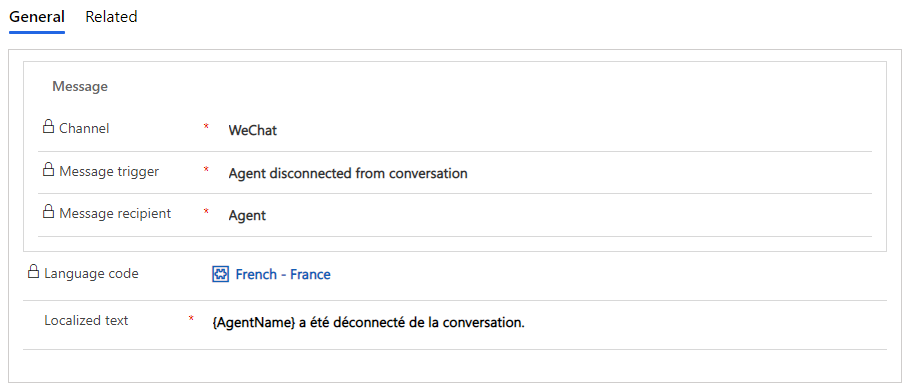
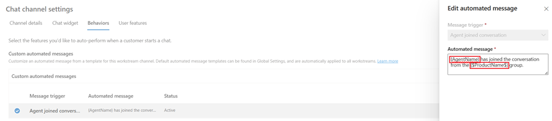

# Configure automated messages

[!INCLUDE[cc-feature-availability-embedded-yes](../../includes/cc-feature-availability-embedded-yes.md)]

[!INCLUDE[cc-rebrand-bot-agent](../../includes/cc-rebrand-bot-agent.md)]

Automated messages are system messages that are sent to customers or customer service representatives (service representatives or representatives) when specific events occur in a conversation, such as when a representative joins, a customer waits in a queue, or a conversation ends. You can configure automated messages for channels such as chat, voice, SMS, and social channels.

You can configure automated messages at two levels:

- **Channel level**: Customize, activate, or deactivate a message for all instances of a channel. For example, all Facebook accounts or all SMS numbers.
- **Channel instance level**: Add custom messages for one specific instance. For example, one Facebook account or one SMS number.

To configure automated messages, complete these tasks:

1. [Review the available triggers](#preconfigured-automated-message-triggers) and identify which ones apply to your channel.
1. [Customize the messages at the channel level](#customize-automated-messages-at-the-channel-level) for text that should apply to all instances of a channel.
1. [Customize the messages at the channel instance level](#customize-automated-messages-at-the-channel-instance-level) only for instances that need different text.
1. [Test your automated messages](#test-your-automated-messages) before you make the channel available to customers.

## How channel-level and channel instance-level messages work together

Use the following rules to understand which message is sent:

| If you... | Then... |
|---|---|
| Don't create custom messages for a channel instance | The instance inherits the channel-level settings. |
| Create custom messages for a channel instance | The channel-level settings are overwritten for that instance. |
| Deactivate a message that's configured for an overflow condition | The default automated message plays for the overflow action. |
| Enable a post-call survey for the workstream | The system doesn't play the agent disconnect message to the customer. |
| Use context variables in a voice channel message | Context variables aren't supported for the voice channel. |

> [!NOTE]
> Automated messages aren't shown in the customer chat transcript.

## Prerequisites

- The channel and channel instance are configured in a workstream. Learn more in [Channels](../use/channels.md).
- If you plan to use holiday or out-of-operating-hours messages, holidays and operating hours are set up for the live chat, channel, or queue.
- If you plan to use context variables in messages, the context variables are defined. Learn more in [Manage context variables](manage-context-variables.md).

## Display a list of all automated messages

You can view a list of all representative-facing and customer-facing automated messages in your contact center environment.

1. In the site map of Copilot Service admin center, select **Customer Settings** in **Customer support**. The **Customer settings** page appears.
1. In the **Automated messages** section, select **Manage**. The **Automated messages** page is displayed.

    > [!div class=mx-imgBorder]
    > !\[Screenshot of the Automated messages page that lists all automated messages.](../media/automated-messages-list.png "Display all automated messages")

1. To edit the language code and text, select one or more of the records. To deactivate messages, select **Deactivate**.

    > [!IMPORTANT]
    > If you configure overflow conditions and deactivate the message for the overflow condition, the default automated message plays for the overflow action.

## Customize automated messages at the channel level

Customize a message at the channel level to apply the change to all instances within a channel. For example, all Facebook accounts or all SMS numbers.

1. On the **Automated messages** page, select a message, and then select **Edit**.
1. On the **General** tab, edit the **Localized text** field, and then select **Save**.

    > [!div class=mx-imgBorder]
    > \

### Use placeholders in messages

The message field supports two types of placeholders: slugs and context variables. The system replaces placeholders with their values at runtime.

#### Slugs

| **Slug** | **Description** |
|----------|-----------------|
| {AgentName} | The full name of the service representative assigned to the conversation. |
| {QueueName} | The name of the queue. |

#### Context variables

To insert a context variable, use the syntax `{$ContextVariableName$}`, as shown in the following example.

> [!div class=mx-imgBorder]
> \

> [!NOTE]
> Context variables in the message field aren't supported for the voice channel.

Follow these rules when you use context variables:

- Enclose context variables in curly braces with dollar signs. For example: `{$VariableName$}`.
- Match the variable name defined in the context variables exactly, including capitalization.
- Use only alphanumeric characters and underscores. For example: `{$User_ID$}`. Except for curly braces and dollar signs, special characters aren't allowed.
- Don't include spaces in names. For example, `{$User Name$}` is invalid. Use `{$UserName$}` instead.
- Don't leave context variables empty. For example, `{$ $}` is invalid.

If the system can't find the matching context variable, it replaces the placeholder with an empty string.

Learn more in [Manage context variables](manage-context-variables.md).

## Customize automated messages at the channel instance level

Customize a message at the channel instance level to apply the change to one instance only. For example, one Facebook account or one SMS number.

> [!IMPORTANT]
> If you create custom automated messages at the channel instance level, the channel-level settings are overwritten for that instance. Learn more in [How channel-level and channel instance-level messages work together](#how-channel-level-and-channel-instance-level-messages-work-together).

### Add custom automated messages

1. In Copilot Service admin center, go to the workstream, and then edit the channel instance.
1. On the **Behaviors** page, in the **Custom automated messages** area, select **Add message**.
1. On the **Add automated message** pane, select a trigger from the **Select a message trigger** list.
1. In the **Automated message** box, enter the message.
1. Select **Confirm**.
1. To create more messages, repeat steps 3 through 5.
1. Save the settings.

### Add a wait time notification for the Messaging API channel

For a Messaging API channel instance, you can notify customers of their position in the queue while they wait.

1. Follow steps 1 through 3 in [Add custom automated messages](#add-custom-automated-messages), and select the **Estimate Wait Time Notification** trigger.
1. Complete the following options:

    - **Automated message**: Enter the message. Use the `{QueuePosition}` variable anywhere in the message to show the customer's current position in the queue.
    - **Message interval**: Specify the time interval, in minutes, after which the message is sent.
    - **isRecurring**: Optionally, turn on this toggle to repeat the message until a representative is assigned.

1. Select **Confirm**, and then save the settings.

## Preconfigured automated message triggers

The following tables group the preconfigured triggers by conversation stage. The tables note triggers that apply only to specific channels.

### Conversation start and routing

| **Message trigger** | **When it's sent** | **Recipient** |
|---|---|---|
| Greeting Message for Async Channels and Voice | As the first message the customer receives. For voice, the message plays as soon as the call connects. If you enable the AI agent, ensure that the automated greeting message is different from the agent message. | Customer |
| Holiday message to customer | The customer starts a conversation on a holiday that you set up for the live chat, channel, or queue. | Customer |
| Out of operating hour message to customer | The customer starts a conversation outside of the business hours that you set up for the live chat, channel, or queue. | Customer |
| Agent couldn't be assigned to conversation | Work distribution fails, or routing can't add the representative to the chat because of a system failure. For example, no representatives are available in the queue, or the default queue isn't found. This trigger doesn't apply when a matching representative can't be identified based on the assignment configuration. | Customer |

### Waiting in queue

| **Message trigger** | **When it's sent** | **Recipient** |
|---|---|---|
| Average wait time for customers: Hours | The customer is waiting in the queue. The average wait time is shown in hours. Applies to live chat and voice channels only. | Customer |
| Average wait time for customers: Hours and minutes | The customer is waiting in the queue. The average wait time is shown in hours and minutes. Applies to live chat and voice channels only. | Customer |
| Average wait time for customers: Minutes | The customer is waiting in the queue. The average wait time is shown in minutes. Applies to live chat and voice channels only. | Customer |
| Customer is next in line | The customer is next in line in the queue. | Customer |
| Customer's position in queue | The customer is waiting in the queue at the second position or beyond. | Customer |
| Estimate Wait Time Notification | At the interval you specify. If **isRecurring** is on, the message repeats until a representative is assigned. Applies to Messaging API channel instances. Learn more in [Add a wait time notification for the Messaging API channel](#add-a-wait-time-notification-for-the-messaging-api-channel). | Customer |

### Representative activity

| **Message trigger** | **When it's sent** | **Recipient** |
|---|---|---|
| Agent assigned to a conversation | A representative is assigned to the conversation. | Customer |
| Agent joined conversation | The representative accepts the notification. | Customer |
| Agent joined customer conversation | The representative joins a customer conversation. | Customer |
| Agent left customer conversation | The representative leaves a customer conversation. | Customer |
| Agent disconnected from conversation | The representative is disconnected because of a closed browser tab, a closed browser, offline presence, or a network issue. Isn't sent if a post-call survey is enabled for the workstream. | Customer |
| Consult accepted | Another representative accepts the consult request. | Customer |
| Consult session ended | The consulted representative closes the session. | Customer |
| Transfer to agent accepted | Another representative accepts the transfer request. | Customer |

### Conversation end

| **Message trigger** | **When it's sent** | **Recipient** |
|---|---|---|
| Agent ended conversation | The representative selects **End**. | Customer |
| Session ended | The representative ends the conversation and closes the session. | Customer |
| Customer disconnected from conversation | The customer closes the browser tab or is disconnected because of a network issue. | Representative |

### Callback and overflow (voice)

| **Message trigger** | **When it's sent** | **Recipient** |
|---|---|---|
| Offer customer callback | The customer calls and the wait time is longer than expected. | Customer |
| Customer callback response | The customer presses 1 on the call menu to accept the callback offer. A confirmation message plays. | Customer |
| Queue overflow conditions where the corresponding action is direct callback | The message asks the customer if they prefer a callback instead of waiting in the queue. It first plays after the customer waits for 30 seconds, and then repeats every 120 seconds until the customer selects the option, ends the call, or is connected to a representative. | Customer |

### Copilot agent fallback (voice)

Set up these messages as fallback messages that play whenever the Copilot agent becomes unresponsive during the customer's call. Customize the text of each message.

| **Message trigger** | **What happens** | **Default message** | **Recipient** |
|---|---|---|---|
| Prompt and transfer to external number | The voice agent plays the message, and then transfers the call to a specified external number. | "Please hold while we transfer your call to an agent." | Customer |
| Prompt and escalate | The voice agent plays the message, and then transfers the call to a service representative. | "Please hold while we transfer your call to an agent." | Customer |
| Prompt and hang up | The voice agent plays the message, and then ends the call. | "We're currently unable to process your call. We apologize for the inconvenience. Please try calling us again later." | Customer |

> [!NOTE]
> Supported locales are listed in the out-of-the-box system messages in Copilot Service admin center.

## Example: Customize messages for a channel and one instance

This example shows how channel-level and channel instance-level messages work together. Contoso has two SMS numbers: a general support number and a priority support number.

1. **Customize the channel-level message.** On the **Automated messages** page, Contoso edits the **Agent assigned to a conversation** message for the SMS channel to: "Hi, I'm {AgentName} from the {QueueName} team. How can I help?" Both SMS numbers inherit this message.
1. **Customize one instance.** Contoso edits the priority support channel instance, and on the **Behaviors** page, adds a custom message for the **Agent assigned to a conversation** trigger: "Thank you for contacting Priority Support. A specialist will help you now."
1. **Result.** When a representative is assigned, customers who text the general support number receive the channel-level message. Customers who text the priority support number receive the custom message.

## Test your automated messages

Before you make the channel available to customers, use the following checklist to verify your configuration in a test environment:

- [ ] Each message is active for the triggers you need, and deactivated for triggers you don't need.
- [ ] Each trigger you configured applies to the channel. Review the channel notes in [Preconfigured automated message triggers](#preconfigured-automated-message-triggers).
- [ ] Messages exist for each locale your customers use.
- [ ] Slugs and context variables use the correct syntax, and the context variables are defined. Don't use context variables in voice channel messages.
- [ ] Start a test conversation on each channel instance you customized, and on at least one instance that inherits the channel-level settings. Confirm that the expected message appears for each trigger.
- [ ] Context variables are replaced with values, not empty strings.
- [ ] Holiday and out-of-operating-hours messages appear when you start a test conversation outside the configured hours.
- [ ] For voice, the greeting message is different from the AI agent message, and messages are short enough not to delay the connection to a representative.
- [ ] If you enable a post-call survey for the workstream, you don't expect the agent disconnect message to play.

> [!TIP]
> Automated messages don't show in the customer chat transcript, so verify messages during the live test conversation.

## Best practices for using automated messages

Use the following best practices when you configure automated messages for the voice channel:

- Keep automated and custom messages concise. Lengthy messages can delay representatives from connecting with customers.
- Consider configuring **Greeting Message for Async Channels and Voice** instead of **Agent assigned to a conversation**.
- If you configure both **Agent assigned to a conversation** and **Greeting Message for Async Channels and Voice**, consider configuring **Greeting Message for Async Channels and Voice** to avoid the accumulation of messages in the queue.
- Deactivate messages that announce the average wait time, unless your business requires that customers know this information.

## Next steps

[Add a chat widget](add-chat-widget.md)

### Related information

[Channels](../use/channels.md)  
[Manage context variables](manage-context-variables.md)

[!INCLUDE[footer-include](../../includes/footer-banner.md)]
